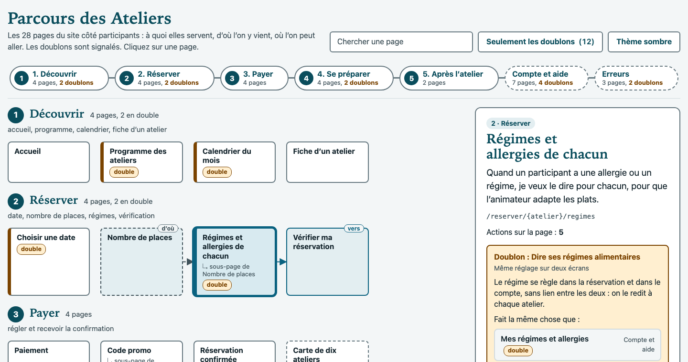

# carte-du-parcours

Un skill pour Claude Code qui fait la **carte du parcours** d'un produit numérique : toutes les pages (ou tous les écrans), ce à quoi chacune sert en une phrase, d'où l'on y vient, où l'on peut aller, et ce qui est fait deux fois. Le résultat est un inventaire (un fichier JSON) et une **carte HTML navigable en un seul fichier**, sans dépendance, prête à ouvrir dans un navigateur ou à publier comme artefact.



## À quoi ça sert

Un produit grandit page par page. Au bout d'un an, personne ne sait combien d'écrans il compte, lesquels se ressemblent, lesquels ne mènent nulle part. La carte rend visible :

- **à quoi sert chaque page**, en une phrase du côté de la personne : « Quand je…, je veux…, pour… » ;
- **le parcours** : d'où l'on vient, où l'on peut aller, quelles pages n'ont aucun lien entrant (orphelines) ;
- **les doublons** : le même réglage sur deux écrans, deux chemins vers la même fonction, deux noms pour la même chose, une page d'état refaite.

Elle sert à décider (que garder, que fusionner), à onboarder une personne, à préparer une refonte, à faire un audit RGAA du parcours.

## Ce que fait la carte

- un **ruban des étapes**, cliquable, qui saute à l'étape ;
- une **recherche** (nom, fonction, adresse, sans tenir compte des accents) et un filtre **« seulement les doublons »** ;
- des **cartes par étape** ; au clic, une **fiche** à droite : fonction, étape, adresse, nombre d'actions, doublons avec la page doublée, pages précédentes et sous-pages cliquables, bouton **Retour**, **flèches** vers les pages voisines ;
- **clair et sombre** (suit le système, un bouton force l'un ou l'autre), contrastes mesurés ;
- pensée pour l'**ordinateur d'abord** (environ 1 440 x 760), sans casse sur petit écran ;
- accessible : clavier, focus visible, jamais d'information par la seule couleur (méthode RGAA dans `methode/LISEZ-MOI.md`).

## Installation

Copiez le dossier dans vos skills Claude Code :

```bash
cp -R carte-du-parcours ~/.claude/skills/carte-du-parcours
```

Le dossier doit s'appeler `carte-du-parcours` et contenir `SKILL.md` à sa racine. Aucune dépendance : les scripts sont en Python 3.8 ou plus.

## Utilisation

Dans Claude Code, dans le dossier du projet à cartographier :

> Fais la carte du parcours de cette application. Le « je », c'est la cliente. Les étapes sont : Découvrir, Commander, Après la commande. Périmètre : le site public, sans l'espace admin.

Claude pose les questions qui manquent (périmètre, rôle, étapes officielles, date), lit le code, écrit `inventaire.json`, contrôle, puis construit `carte-du-parcours.html`. Il vous rend l'inventaire (la source), la carte, et la liste de ce qu'elle ne couvre pas. Il ne publie rien sans votre accord.

### Sans Claude

```bash
python3 scripts/brouillon.py ~/mon-projet -o inventaire.json   # premier jet à compléter
python3 scripts/verifier.py inventaire.json                    # contrôles
python3 scripts/construire.py inventaire.json -o sortie/       # la carte, puis son contrôle statique (controler_html.py)
python3 scripts/contrastes.py sortie/carte-du-parcours.html    # contrastes, clair et sombre
```

`construire.py` écrit deux fichiers : `carte-du-parcours.html` (page complète, à ouvrir ou à héberger) et `carte-du-parcours.artefact.html` (sans balises `<html>`, `<head>` ni `<body>`, pour l'outil Artifact de Claude).

## Tester l'exemple

Ouvrez `exemple/carte-du-parcours-exemple.html` dans un navigateur : double-clic, rien à installer. C'est la carte d'un produit **fictif** (« Les Ateliers de la Halle », une réservation d'ateliers de cuisine de quartier) : 30 pages, 8 étapes, 6 groupes de doublons, une page orpheline, une page à construire, un espace animateur replié. Les données sont dans `exemple/inventaire-exemple.json` ; la carte se refait avec :

```bash
python3 scripts/construire.py exemple/inventaire-exemple.json --nom carte-du-parcours-exemple
```

## Contenu du dépôt

```
SKILL.md                      le skill : les étapes à suivre
methode/LISEZ-MOI.md          la méthode : phrase de fonction, actions, contrôles, RGAA
methode/format-inventaire.md  les champs de inventaire.json
recettes/                     extraire l'inventaire (web, site statique, mobile) et repérer les doublons
modele/carte.html             le gabarit : un bloc de données JSON, tout le reste est générique
modele/inventaire-vide.json   un inventaire minimal pour partir
exemple/                      carte d'exemple complète, entièrement fictive
scripts/                      brouillon.py, verifier.py, construire.py, controler_html.py, contrastes.py
evals/                        deux cas de test du skill, avec leurs projets d'essai fictifs
```

## Limites connues

- Le brouillon lit le code par expressions régulières : il rate les routes construites dynamiquement, les gestionnaires d'erreur et les écrans composés à la volée. Il est fait pour gagner du temps, pas pour remplacer la lecture.
- La carte est un **état daté du possible**, pas une mesure de l'usage réel.
- Les flèches du schéma sont tracées pour la disposition ordinateur ; elles sont masquées sur petit écran, où la fiche liste les voisines.
- Les couleurs sont des jetons à changer dans `:root` (trois blocs) ; relancer `scripts/contrastes.py` après chaque changement.

## Licence

MIT. Voir `LICENSE`.
